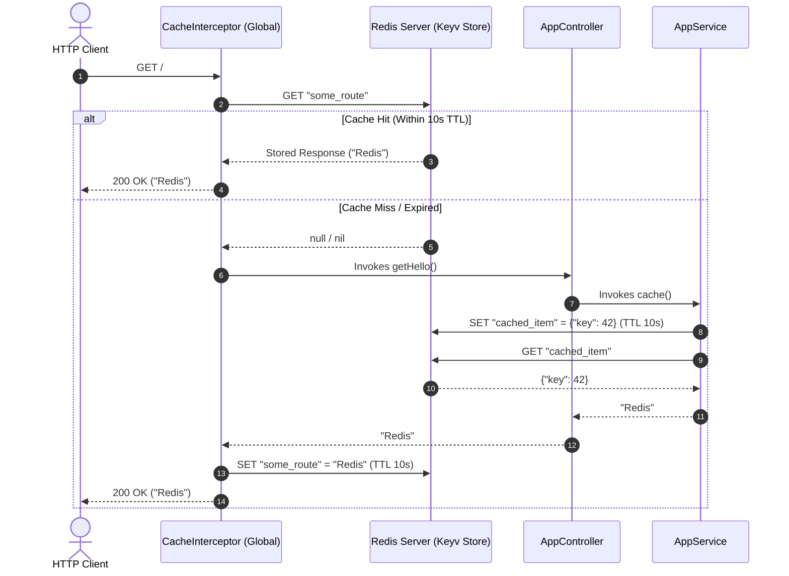

# poc-nestjs-redis-cache

> High-throughput HTTP response and distributed in-memory data caching architecture built on NestJS 11, `@nestjs/cache-manager`, Keyv, and Redis with AOF persistence.

**Inception (First Commit):** `2025-02-22` • **Batch / Horizon:** `Batch 2024–2025` • **Architecture Domain:** `Application Caching & Performance Optimization`

---

## 📌 Architecture & Overview

`nestjs-cache` is an architectural reference and proof-of-concept demonstrating distributed caching strategies in NestJS 11. It explores both declarative HTTP response caching via global interceptors and programmatic application-level caching via the unified `CACHE_MANAGER` interface powered by Redis.

The service decouples application runtime state from process memory by integrating Keyv (`@keyv/redis`) as an external storage adapter. This enables horizontal scaling across multiple container instances without losing cache coherence.

* **Context:** Architectural proof-of-concept and engineering laboratory for caching patterns in NestJS 11, deconstructing the interaction between HTTP interceptors, TTL policies, and external Redis key-value stores.
* **Key Patterns:**
  * **Interceptor Pattern (`CacheInterceptor`):** Declarative transport-level caching applied globally through `APP_INTERCEPTOR`, short-circuiting handler execution on cache hits.
  * **Decorator-Driven Customization:** Granular route overrides using `@CacheKey` (deterministic key naming) and `@CacheTTL` (time-to-live expiration).
  * **Unified Cache Manager Abstraction:** Direct programmatic cache access (`set`, `get`, `del`) inside injectable services via `@Inject(CACHE_MANAGER)`.
  * **Externalized Distributed Storage:** Offloading cache state to a standalone Redis daemon configured with Append-Only File (AOF) durability.

### Request Lifecycle & Caching Flow



---

## 🛠 Tech Stack

* **Runtime & Framework:** Node.js (>= 22 recommended), TypeScript 5.7, NestJS 11.0 (`@nestjs/common`, `@nestjs/core`, `@nestjs/platform-express`)
* **Compilation & Tooling:** SWC compiler (`@swc/cli`, `@swc/core`), Nest CLI, ESLint 9 (Flat Config), Prettier
* **Caching & Storage:**
  * `@nestjs/cache-manager` 3.0.0
  * `cache-manager` 6.4.0
  * `@keyv/redis` 4.2.0
  * Redis 7.x (via official Docker container with `--appendonly yes`)
* **Testing:** Jest 29.7, `ts-jest` 29.2, Supertest 7.0

---

## ✨ Features & Endpoints

* **Declarative Route Caching:** `AppController` maps `GET /` to a fixed cache key `some_route` with a custom TTL of 10,000 ms (10 seconds), preventing repeated handler invocation during traffic spikes.
* **Programmatic Cache Control:** `AppService` demonstrates direct cache mutation and retrieval using the `CACHE_MANAGER` token, supporting complex JSON object storage (`{ key: 42 }`).
* **Containerized Redis Backbone:** Standalone `docker-compose.yaml` provisioning Redis with persistent storage configured via AOF (`--appendonly yes`) and port mapping `6379:6379`.
* **Structured Service Logging:** Built-in NestJS `Logger` instrumentation tracking cache misses and payloads directly in console output.

### Key API Routes & Interfaces

| Method | Route | Cache Key | TTL | Description |
|---|---|---|---|---|
| `GET` | `/` | `some_route` | 10,000 ms (10s) | Returns `'Redis'`. First invocation executes `AppService.cache()` and persists `{ key: 42 }` into Redis. Subsequent calls within 10s return the cached HTTP response directly from Redis without executing service logic. |

---

## 🚀 Getting Started

### Prerequisites

* **Node.js** `>= 22.0.0`
* **pnpm** `>= 9.0.0` (repository uses `pnpm-lock.yaml`)
* **Docker & Docker Compose** (for running the local Redis container)

### 1. Installation

Clone the repository and install dependencies using `pnpm`:

```bash
git clone https://github.com/fabogit/poc-nestjs-redis-cache.git
cd poc-nestjs-redis-cache

pnpm install
```

### 2. Start Redis Infrastructure

Start the Redis instance in detached mode via Docker Compose:

```bash
docker compose up -d
```

Verify that Redis is healthy and accepting connections on port 6379:

```bash
docker compose ps
docker exec -it redis redis-cli ping
# Expected output: PONG
```

### 3. Environment Configuration

By default, the application connects to Redis on `redis://localhost:6379` and listens on port `3000`. You can optionally set a custom port:

```bash
export PORT=3000
```

### 4. Running the Application

```bash
# Development mode with hot-reload
pnpm run start:dev

# Production build and execution
pnpm run build
pnpm run start:prod
```

### 5. Verifying Cache Behavior

Send an initial request to trigger cache population:

```bash
curl -i http://localhost:3000/
```

* **First Request:** The service executes `AppService.cache()`, setting `cached_item` and returning `Redis`. The application logs:
  ```text
  [AppService] Item cached { key: 42 }
  ```
* **Subsequent Requests (within 10s):** `CacheInterceptor` intercepts the call, serving the response directly from the Redis key `some_route`. No log is emitted by `AppService`.
* **Inspect Keys in Redis CLI:**
  ```bash
  docker exec -it redis redis-cli keys "*"
  # Shows "keyv:some_route" and "keyv:cached_item"
  ```

### 6. Running Tests

```bash
# Unit tests
pnpm test

# Test coverage
pnpm run test:cov
```

> [!NOTE]
> For End-to-End (E2E) testing, see the architectural notes below regarding `pnpm run test:e2e`.

---

## ⚠️ Architectural Considerations & Known Quirks

1. **HTTP vs Service-Level Cache Layering:**
   Because `CacheInterceptor` is registered globally via `APP_INTERCEPTOR`, any HTTP-level cache hit bypasses `AppService.cache()` entirely. The programmatic calls to `cacheManager.set()` and `cacheManager.get()` inside `AppService` will only execute when the HTTP cache expires.
2. **Hardcoded Connection URI:**
   `AppModule` configures `createKeyv('redis://localhost:6379', {})` directly in code. For containerized or Kubernetes deployment, this must be refactored to read from `process.env.REDIS_URL` or NestJS `ConfigService`.
3. **E2E Test Assertion Discrepancy:**
   The default boilerplate in `test/app.e2e-spec.ts` tests for `expect('Hello World!')`, while `AppController.getHello()` returns `'Redis'`. Running `pnpm run test:e2e` fails until the test assertion is updated to expect `'Redis'`.

---

## 📄 License & Author

Developed by [@fabogit](https://github.com/fabogit).
Licensed under [UNLICENSED](package.json).
